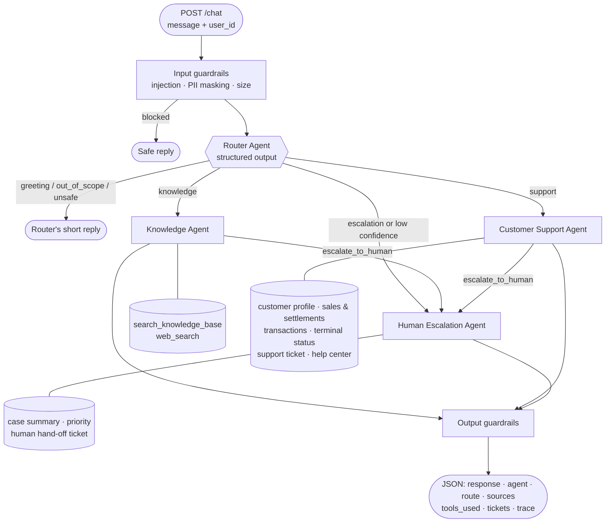

# Getnet Multi-Agent Support System

A multi-agent customer assistant for Getnet merchants. A **Router Agent** reads each message and hands it to a
**Knowledge Agent** (RAG over Getnet's website + web search), a **Customer Support Agent** (tools over the merchant's
account data) or a **Human Escalation Agent**. Guardrails run before and after the agents, every step is traced, and the
whole thing ships as a single Docker service exposing `POST /chat`.

- **Language / stack:** Python 3.13, FastAPI, Google Gemini (LLM + embeddings), numpy vector store, DuckDuckGo search
- **Agents:** Router · Knowledge · Customer Support · Human Escalation (bonus)
- **Bonus features:** guardrails, human hand-off, tracing, metrics endpoint, evaluation dataset + LLM-as-judge

---

## 1. Quick start

**Requirements:** Docker (with Compose) and a free Gemini API key from <https://aistudio.google.com/apikey>.

```bash
git clone <this-repo> && cd getnet-multi-agent
cp .env.example .env          # then edit .env and set GEMINI_API_KEY
docker compose up --build
```

On the first start the service crawls the Getnet website and builds the vector index (about 1–3 minutes; progress
appears in the logs). The index is stored in a Docker volume, so later starts are instant.
`GET http://localhost:8000/health` returns `"status": "ok"` when the knowledge base is loaded.

Send a message:

```bash
curl -s -X POST http://localhost:8000/chat \
  -H "Content-Type: application/json" \
  -d '{"message": "What is the difference between the Get Clássica and the Get Smart?", "user_id": "cliente1988"}'
```

**Web console:** <http://localhost:8000/> — a small chat UI that shows, for every answer, which agent handled it,
the route and confidence, the tools called, the sources and a step-by-step trace with latencies. It also lets you
switch between the mock merchants and run the example scenarios with one click.

Interactive API docs (Swagger UI): <http://localhost:8000/docs>

Run all the challenge's example scenarios and print a readable summary:

```bash
docker compose exec api python scripts/demo.py
```

### Useful commands

| Task | Command |
|---|---|
| Run the test suite (offline, no API key needed) | `docker compose run --rm api pytest` |
| Run the evaluation suite (real LLM) | `docker compose run --rm api python -m evals.run_evals --judge` |
| Rebuild the knowledge base | `docker compose run --rm api python -m app.rag.ingest` |
| Follow the structured logs | `docker compose logs -f api` |
| Operational metrics | `curl http://localhost:8000/metrics` |

### Configuration

All settings are environment variables (see `.env.example`). The most relevant:

| Variable | Default | Purpose |
|---|---|---|
| `GEMINI_API_KEY` | – | Required |
| `LLM_MODEL` | `gemini-flash-lite-latest` | Model for the specialist agents |
| `ROUTER_MODEL` | `gemini-flash-lite-latest` | Model for routing |
| `LLM_THINKING_LEVEL` | `low` | Reasoning effort for thinking models |
| `EMBEDDING_MODEL` | `gemini-embedding-001` | Embeddings for RAG (768 dims) |
| `MAX_TOOL_ITERATIONS` | `5` | Hard cap on each agent's tool loop |
| `ROUTER_CONFIDENCE_THRESHOLD` | `0.55` | Below this, the request goes to a human |
| `RETRIEVAL_TOP_K` / `RETRIEVAL_MIN_SCORE` | `5` / `0.45` | Retrieval breadth and relevance floor |

The `-latest` aliases always resolve to the current Gemini release. To pin a version (recommended for production
reproducibility), set an exact model id from <https://ai.google.dev/gemini-api/docs/models>.

### Running without Docker

```bash
python -m venv .venv && source .venv/bin/activate
pip install -r requirements.txt
cp .env.example .env   # set GEMINI_API_KEY
uvicorn app.main:app --reload
pytest
```

---

## 2. Architecture



### The agents

| Agent | Responsibility | How it works | Tools |
|---|---|---|---|
| **Router** | Entry point. Decides who handles the message. | One LLM call with a JSON schema → `route`, `confidence`, `language`, `reason`, `reply`. Validated defensively: invalid output becomes a 0-confidence decision. | – |
| **Knowledge** | Getnet products & services; general real-time questions. | Tool-calling loop. Searches the knowledge base first, falls back to the web, answers only from tool results. | `search_knowledge_base`, `web_search`, `escalate_to_human` |
| **Customer Support** | The merchant's own account: deposits, transactions, declines, card machines. | Tool-calling loop over the merchant's data; uses the help center for official procedures; opens tickets when troubleshooting is not enough. | `get_customer_profile`, `get_sales_and_settlements`, `get_recent_transactions`, `get_terminal_status`, `open_support_ticket`, `search_knowledge_base`, `escalate_to_human` |
| **Human Escalation** (bonus) | Hand-off to a human specialist. | LLM produces a case summary, priority and category (structured output), then a hand-off ticket is created and the user gets a protocol number. Falls back to a template if the LLM fails. | creates `HUM-` tickets |

### Communication between agents

The **orchestrator** (`app/orchestrator.py`) owns the workflow. Agents communicate through **direct, synchronous function
calls** that share one request-scoped `ToolContext` (user id, trace, collected sources, tickets, escalation flag).

- Specialists never call each other directly. When one decides a human is needed, it calls the `escalate_to_human`
  tool, which only raises a flag; the orchestrator then runs the Escalation Agent. All routing decisions stay in one place.
- Knowledge is shared through tools: the Support Agent uses the same `search_knowledge_base` tool as the Knowledge Agent,
  so "my machine won't connect" combines live diagnostics with the official help-center procedure.

I chose direct calls over a message queue because every interaction is a short request/response: it is the easiest
model to trace, test and reason about. A queue becomes worth it with long-running or asynchronous agents (see §8).

### Message workflow example

`"When will the money from yesterday's sales be deposited?"` from `cliente1988`:

1. **Input guardrails:** no injection, no sensitive data → forwarded unchanged.
2. **Router:** `{"route": "support", "confidence": 0.95, "language": "en"}`.
3. **Support Agent, iteration 1:** the model calls `get_sales_and_settlements(period="yesterday")`. The tool reads
   **cliente1988's** data (the user id comes from the request, never from the model) and returns each sale with its
   expected deposit dates: debit D+1, Pix same day, credit D+30, installments every 30 days.
4. **Support Agent, iteration 2:** the model writes the answer from those numbers.
5. **Output guardrails:** masks any sensitive data the model might echo.
6. **Response:** answer + `agent`, `route`, `tools_used`, `sources`, `tickets` and the full `trace` with per-step latency
   and token usage.

---

## 3. RAG pipeline

```
data/sources.txt ──► crawl ──► clean ──► chunk ──► embed ──► storage/index.json
                                                                    │
user question ──► embed (query) ──► cosine top-k ──► relevance floor ──► LLM answer + sources
```

| Stage | Implementation | Why |
|---|---|---|
| **Ingestion** | `app/rag/ingest.py` crawls the seed URLs in `data/sources.txt` (getnet.net + site.getnet.com.br: card machines, Pix, crediário, payment link, digital account, loans, help center) and follows same-domain links one level deep (max 60 pages). Sequential, 0.5 s delay, identified User-Agent, public pages only. On getnet.net only the English edition is kept; legal, press and blog pages are skipped. | The challenge asked for sources beyond the suggested URL. Following one level of links catches product pages without hard-coding them all. getnet.net's country editions (Portugal, Spain, Mexico…) describe other markets' products and fees and would give Brazilian merchants wrong answers. |
| **Cleaning** | BeautifulSoup removes scripts, nav, header, footer, cookie banners; drops very short UI fragments and duplicate lines. | Menus and banners repeated on every page would otherwise dominate retrieval. |
| **Chunking** | Paragraph-aware, ~1000 characters with 150 overlap; the page title is prefixed to every chunk; duplicate chunks across pages are removed. | Paragraph boundaries keep ideas intact; overlap keeps answers that span a boundary; the title tells the model which product a chunk is about. |
| **Embedding** | `gemini-embedding-001`, 768 dimensions, `RETRIEVAL_DOCUMENT` for chunks and `RETRIEVAL_QUERY` for questions. | Multilingual: English questions retrieve Portuguese content. Asymmetric task types improve retrieval quality. |
| **Storage** | `app/rag/store.py`: unit-normalized vectors in numpy, persisted as JSON in a Docker volume. | For a few hundred chunks, exact brute-force search takes well under 1 ms and has no infrastructure to run. The interface (`add` / `search` / `save` / `load`) maps directly to Chroma, pgvector or Qdrant if the corpus grows. |
| **Retrieval** | Cosine similarity, top-5, minimum score 0.45. | Irrelevant chunks are worse than none: they invite the model to improvise. |
| **Generation** | The Knowledge Agent calls `search_knowledge_base` (it may reformulate and search again), then answers only from the results. Sources are returned in a separate `sources` field. | Grounding rules live in the prompt; citations let users and evaluators check the answer. |

---

## 4. How the LLM's tools are used

- **Native function calling.** Each tool is a JSON schema (what the model sees) plus a Python function (what runs).
  The agent loop in `app/agents/base.py` runs tools manually instead of using the SDK's automatic mode, so every tool
  call is logged and traced with its arguments and result.
- **Structured output** (JSON schema) for the Router and the Escalation Agent: decisions are validated data, not text to parse.
- **Model choice is configuration:** router and agents can use different models. I benchmarked the larger Flash model against Flash-Lite on the example scenarios: with the knowledge base doing the heavy lifting, Flash-Lite gave equally grounded answers in ~7 s versus ~50 s (the larger model also hit 504 deadlines on the free tier), so it is the default. Thinking effort is set to `low` for the same reason.
- **Safety by construction:**
  - No tool accepts a `user_id` parameter. The id is injected from the request, so a prompt cannot make the model
    read another merchant's data.
  - Arguments the schema doesn't declare are dropped before execution.
  - Unknown tools and tool exceptions become error results the model can recover from; they never crash the request.
  - The loop is capped at `MAX_TOOL_ITERATIONS`. Hitting the cap escalates to a human instead of failing silently.
- **Provider abstraction.** Agents depend on the `LLMClient` protocol (`app/llm.py`), not on the Gemini SDK. Adding
  another provider means writing one class. The same seam lets the tests use a scripted fake model.
- **Reliability:** request timeout and exponential backoff on 429/5xx errors.

---

## 5. Guardrails and human hand-off (bonus)

**Input** (`app/guardrails.py`, deterministic and tested):

- prompt-injection / jailbreak patterns (English and Portuguese) are blocked before any LLM call;
- card numbers (Luhn-validated, so order numbers are not affected), CVV, passwords, CPF and CNPJ are **masked before
  reaching the LLM or the logs**, and the user is told not to share them;
- empty and oversized messages are rejected.

**Semantic layer:** the Router labels `out_of_scope` (e.g. "write me a script") and `unsafe` requests and replies with
what the assistant *can* do.

**Output:** sensitive data is masked again in the final answer. Prompts forbid revealing instructions or inventing
fees, prices or data.

**Human hand-off** happens when:

- the user asks for a human or reports fraud, a chargeback or a legal issue (Router → `escalation`);
- the Router's confidence is below the threshold;
- a specialist calls `escalate_to_human`;
- an agent hits its iteration limit.

The Escalation Agent writes a case summary for the human team, sets priority and category, creates a `HUM-` ticket and
tells the user the protocol number and expected response time.

---

## 6. Testing strategy

Testing an LLM system means separating **what must always be true** (the workflow) from **how good the model is**
(the answers). They need different tools.

| Layer | What it checks | Where | Needs API key? |
|---|---|---|---|
| **Unit** | Guardrails (masking, injection, Luhn), chunking, HTML cleaning, vector search and persistence, settlement-date logic, decline-code mapping, router output parsing | `tests/test_units.py` | No |
| **Integration (orchestration)** | Full flow with a scripted `FakeLLM`: correct agent per scenario, expected tools called, sources returned, escalation paths (explicit, low confidence, specialist-requested, loop cap), injection never reaching the LLM, PII masking end to end, web-search and LLM failures degrading gracefully, user-id isolation, trace and metrics recorded | `tests/test_orchestration.py` | No |
| **API contract** | Response schema, payload validation (422s), `/health`, `/metrics` | `tests/test_api.py` | No |
| **Evaluation (quality)** | Real model on a labelled dataset: routing accuracy, tool-selection accuracy, key-content checks, LLM-as-judge groundedness and helpfulness, latency and tokens | `evals/` | Yes |

The `FakeLLM` (`tests/fakes.py`) implements the same interface as the Gemini client: it routes by keywords, calls the
tool a scenario needs, and answers by echoing tool results. That makes integration tests **deterministic, offline and
fast** (44 tests in under a second), so they can run on every commit. A failing integration test means the
orchestration broke, not that the model had a bad day.

**Comprehensive integration testing for the orchestration** extends this in four directions:

1. **Scenario matrix.** For every route × outcome (answered, tool error, empty retrieval, unknown customer, escalation),
   assert the agent path, the tool sequence and the response contract through the trace.
2. **Contract tests per tool.** Each tool's schema and output shape are pinned, so a change in the data layer cannot
   silently break what the model receives.
3. **Recorded real-model runs.** Record real Gemini responses once and replay them in CI (VCR-style). This catches
   regressions in prompt/response handling without paying for every run.
4. **Evaluation gates.** `evals/run_evals.py` runs on every prompt or model change. A drop in routing accuracy or
   groundedness versus the previous report blocks the change. The dataset grows with every production failure that
   gets fixed (regression tests for behaviour).

---

## 7. Observability, evaluation and production monitoring (bonus)

**What is implemented**

- **Traces:** each request gets a `trace_id`. Every step (guardrails, router decision, each LLM iteration, each tool
  call with arguments and result, escalation) is a span with its latency and token usage. The trace is returned in
  the API response and logged.
- **Structured logs:** one JSON line per span (`trace_id`, `user_id`, `span`, `duration_ms`, attributes), ready for
  Loki, ELK or Datadog. Sensitive data is masked before it reaches the logs.
- **Metrics:** `GET /metrics` exposes requests, errors, routes, guardrail blocks, escalations, tool-call counts,
  tokens and p50/p95 latency per route.
- **Evaluation:** a labelled dataset (`evals/dataset.jsonl`, the 10 challenge scenarios plus Portuguese, escalation,
  out-of-scope, injection and unknown-customer cases) and a runner that writes `evals/report.md`.

**How I would run it in production**

| Signal | Tooling | Alert when |
|---|---|---|
| Latency p95, error rate, LLM 429/5xx | OpenTelemetry → Prometheus / Grafana | p95 > 8 s or error rate > 2% for 5 min |
| Cost | tokens per request and per route | daily spend over budget, or tokens/request jumps (loops, prompt bloat) |
| Routing health | route distribution, router confidence histogram | sudden shift in distribution or many low-confidence routes |
| Escalation rate | escalations / requests | > X% (the assistant is failing) or ≈ 0 (hand-off broken) |
| Retrieval quality | top-1 similarity, % empty retrievals | empty-retrieval rate rises (stale index or site changed) |
| Answer quality | nightly LLM-as-judge on a sample of real conversations; thumbs up/down | groundedness score drops |
| Safety | guardrail blocks by type | spike in injection attempts |

Agent-level tracing tools such as Langfuse or LangSmith fit directly on top of the existing spans.

---

## 8. Design decisions, trade-offs and limitations

- **No agent framework.** The orchestration is about 150 lines of plain Python. With four agents and a clear flow, a
  framework would add abstraction without adding capability, and every step here is explicit and testable. LangGraph
  would be my choice if the flow became a real graph (loops between agents, human-in-the-loop pauses, persistent state).
- **Gemini.** Free tier, and one provider for both the LLM and embeddings. The `LLMClient` abstraction keeps the choice reversible.
- **numpy vector store** instead of a vector database: exact, fast and zero-ops at this size (see §3).
- **DuckDuckGo search** needs no API key. Web results (weather, exchange rates) are approximate snippets, and the agent
  says where they came from. In production I would use dedicated APIs for weather and exchange rates.
- **Mock customer data.** `data/customers.json` is fictitious and uses relative dates, so "yesterday's sales" always
  works. Settlement rules are simplified (business days without holidays).
- **Single-turn.** Each request is independent. Conversation memory (last N turns per user, in Redis) is the next step.
- **Crawl freshness.** The index is built once. In production, a scheduled re-ingestion job would compare page hashes and re-embed only what changed.

**Production evolution:** authentication (the user id from a token, not the payload), conversation memory, async
agents and a queue for long tasks, a managed vector database, re-ingestion jobs, recorded-response CI, and a canary
evaluation before every prompt or model release.

---

## 9. Project structure

```
app/
  main.py               FastAPI app: /, /chat, /health, /metrics; dependency wiring
  static/index.html     Web console (chat + agent path, tools, sources, trace)
  orchestrator.py       Workflow: guardrails → router → specialist → escalation → output
  config.py             Settings (environment variables)
  llm.py                LLMClient interface + Gemini implementation (retries, timeouts)
  guardrails.py         Input/output guardrails
  observability.py      Traces, structured logs, metrics
  agents/
    prompts.py          All system prompts and output schemas (versioned)
    base.py             Tool-calling agent loop
    router.py           Router Agent
    specialists.py      Knowledge, Customer Support and Human Escalation agents
  tools/                Tool definitions (knowledge, support, escalation)
  rag/                  ingest.py (crawl → chunk → embed) · store.py · retriever.py
  data/                 customer_repository.py (mock data access + tickets)
data/
  sources.txt           Seed URLs for the knowledge base
  customers.json        Fictitious merchants (cliente1988, cliente2024)
tests/                  Unit, integration and API tests (offline, fake LLM)
evals/                  Evaluation dataset and runner
scripts/demo.py         Runs the challenge scenarios against the API
```

Mock users for testing: **`cliente1988`** (bakery in Porto Alegre, Get Smart offline with weak Wi-Fi, declined
transactions with codes 51 and 54, sales yesterday in debit, credit, 3× installments and Pix) and **`cliente2024`**
(auto parts store, automatic advance enabled). Any other id behaves as an unknown customer.

---

## Development notes

<!-- Edit this section in your own words before submitting. -->
I built this solution with an AI coding assistant as a pair programmer, which is the way of working this role is
about. I made the architecture decisions, reviewed and tested every part, and I'm happy to walk through any of it.
