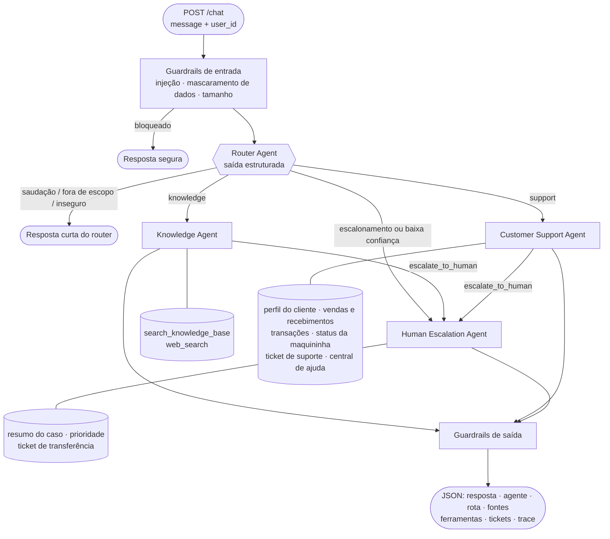

# Sistema Multiagente de Atendimento Getnet

**[Read in English](README.md)**

Um assistente multiagente de atendimento para lojistas da Getnet. Um **Router Agent** lê cada mensagem e a encaminha
para um **Knowledge Agent** (RAG sobre o site da Getnet + busca na web), um **Customer Support Agent** (ferramentas
sobre os dados da conta do lojista) ou um **Human Escalation Agent**. Guardrails rodam antes e depois dos agentes,
cada passo é rastreado, e tudo é entregue como um único serviço Docker que expõe `POST /chat`.

- **Linguagem / stack:** Python 3.13, FastAPI, Google Gemini (LLM + embeddings), vector store em numpy, busca DuckDuckGo
- **Agentes:** Router · Knowledge · Customer Support · Human Escalation (bônus)
- **Recursos bônus:** guardrails, transferência para humano, tracing, endpoint de métricas, dataset de avaliação + LLM-as-judge

---

## 1. Como rodar

**Requisitos:** Docker (com Compose) e uma chave gratuita da API do Gemini em <https://aistudio.google.com/apikey>.

```bash
git clone <este-repositorio> && cd getnet-multi-agent
cp .env.example .env          # depois edite o .env e defina GEMINI_API_KEY
docker compose up --build
```

Na primeira execução, o serviço raspa o site da Getnet e monta o índice vetorial (de 1 a 3 minutos; o progresso
aparece nos logs). O índice fica salvo num volume do Docker, então as próximas inicializações são instantâneas.
`GET http://localhost:8000/health` retorna `"status": "ok"` quando a base de conhecimento está carregada.

Envie uma mensagem:

```bash
curl -s -X POST http://localhost:8000/chat \
  -H "Content-Type: application/json" \
  -d '{"message": "What is the difference between the Get Clássica and the Get Smart?", "user_id": "cliente1988"}'
```

**Console web:** <http://localhost:8000/> — uma pequena interface de chat que mostra, para cada resposta, qual agente
atuou, a rota e a confiança, as ferramentas chamadas, as fontes e um trace passo a passo com as latências. Também
permite alternar entre os lojistas fictícios e rodar os cenários de exemplo com um clique.

Documentação interativa da API (Swagger UI): <http://localhost:8000/docs>

Para rodar todos os cenários de exemplo do desafio e imprimir um resumo legível:

```bash
docker compose exec api python scripts/demo.py
```

### Comandos úteis

| Tarefa | Comando |
|---|---|
| Rodar os testes (offline, sem chave de API) | `docker compose run --rm api pytest` |
| Rodar a avaliação (LLM real) | `docker compose run --rm api python -m evals.run_evals --judge` |
| Refazer a base de conhecimento | `docker compose run --rm api python -m app.rag.ingest` |
| Acompanhar os logs estruturados | `docker compose logs -f api` |
| Métricas operacionais | `curl http://localhost:8000/metrics` |

### Configuração

Todas as configurações são variáveis de ambiente (veja o `.env.example`). As mais relevantes:

| Variável | Padrão | Para que serve |
|---|---|---|
| `GEMINI_API_KEY` | – | Obrigatória |
| `LLM_MODEL` | `gemini-flash-lite-latest` | Modelo dos agentes especialistas |
| `ROUTER_MODEL` | `gemini-flash-lite-latest` | Modelo do roteamento |
| `LLM_THINKING_LEVEL` | `low` | Nível de raciocínio dos modelos com "thinking" |
| `EMBEDDING_MODEL` | `gemini-embedding-001` | Embeddings para o RAG (768 dimensões) |
| `MAX_TOOL_ITERATIONS` | `5` | Limite de voltas no loop de ferramentas de cada agente |
| `ROUTER_CONFIDENCE_THRESHOLD` | `0.55` | Abaixo disso, o pedido vai para um humano |
| `RETRIEVAL_TOP_K` / `RETRIEVAL_MIN_SCORE` | `5` / `0.45` | Quantidade de trechos buscados e piso de relevância |

Os aliases `-latest` sempre apontam para a versão atual do Gemini. Para fixar uma versão (recomendado em produção,
por reprodutibilidade), defina um id exato de modelo de <https://ai.google.dev/gemini-api/docs/models>.

### Rodando sem Docker

```bash
python -m venv .venv && source .venv/bin/activate
pip install -r requirements.txt
cp .env.example .env   # defina GEMINI_API_KEY
uvicorn app.main:app --reload
pytest
```

---

## 2. Arquitetura



### Os agentes

| Agente | Responsabilidade | Como funciona | Ferramentas |
|---|---|---|---|
| **Router** | Porta de entrada. Decide quem responde a mensagem. | Uma chamada ao LLM com schema JSON → `route`, `confidence`, `language`, `reason`, `reply`. Validação defensiva: uma saída inválida vira uma decisão com confiança 0. | – |
| **Knowledge** | Produtos e serviços da Getnet; perguntas gerais em tempo real. | Loop com ferramentas. Busca primeiro na base de conhecimento, recorre à web se precisar e responde só com o que as ferramentas trouxeram. | `search_knowledge_base`, `web_search`, `escalate_to_human` |
| **Customer Support** | A conta do próprio lojista: depósitos, transações, recusas, maquininhas. | Loop com ferramentas sobre os dados do lojista; usa a central de ajuda para procedimentos oficiais; abre tickets quando a solução de problemas não basta. | `get_customer_profile`, `get_sales_and_settlements`, `get_recent_transactions`, `get_terminal_status`, `open_support_ticket`, `search_knowledge_base`, `escalate_to_human` |
| **Human Escalation** (bônus) | Transferência para um especialista humano. | O LLM gera um resumo do caso, a prioridade e a categoria (saída estruturada); depois um ticket é criado e o usuário recebe um número de protocolo. Usa um modelo de mensagem pronto se o LLM falhar. | cria tickets `HUM-` |

### Comunicação entre os agentes

O **orquestrador** (`app/orchestrator.py`) é dono do fluxo. Os agentes se comunicam por **chamadas de função diretas e
síncronas**, que compartilham um `ToolContext` da requisição (id do usuário, trace, fontes coletadas, tickets, sinal de
escalonamento).

- Os especialistas nunca chamam uns aos outros. Quando um decide que precisa de um humano, ele chama a ferramenta
  `escalate_to_human`, que só levanta um sinal; o orquestrador então roda o Escalation Agent. Todas as decisões de
  roteamento ficam num lugar só.
- O conhecimento é compartilhado por ferramentas: o Support Agent usa a mesma `search_knowledge_base` do Knowledge Agent,
  então "minha maquininha não conecta" combina o diagnóstico em tempo real com o procedimento oficial da central de ajuda.

Escolhi chamadas diretas em vez de uma fila de mensagens porque cada interação é um pedido e uma resposta curtos: é o
modelo mais fácil de rastrear, testar e entender. Uma fila passa a valer a pena com agentes demorados ou assíncronos
(veja a §8).

### Exemplo do fluxo de uma mensagem

`"When will the money from yesterday's sales be deposited?"` enviada pelo `cliente1988`:

1. **Guardrails de entrada:** sem injeção e sem dado sensível → segue sem alteração.
2. **Router:** `{"route": "support", "confidence": 0.95, "language": "en"}`.
3. **Support Agent, iteração 1:** o modelo chama `get_sales_and_settlements(period="yesterday")`. A ferramenta lê os dados
   do **cliente1988** (o id do usuário vem da requisição, nunca do modelo) e devolve cada venda com as datas previstas
   de depósito: débito D+1, Pix no mesmo dia, crédito D+30, parcelado a cada 30 dias.
4. **Support Agent, iteração 2:** o modelo escreve a resposta com esses números.
5. **Guardrails de saída:** mascaram qualquer dado sensível que o modelo tenha repetido.
6. **Resposta:** o texto + `agent`, `route`, `tools_used`, `sources`, `tickets` e o `trace` completo, com a latência e o
   uso de tokens de cada passo.

---

## 3. Pipeline de RAG

```
data/sources.txt ──► raspagem ──► limpeza ──► chunks ──► embeddings ──► storage/index.json
                                                                              │
pergunta ──► embedding (consulta) ──► top-k por cosseno ──► piso de relevância ──► resposta do LLM + fontes
```

| Etapa | Implementação | Por quê |
|---|---|---|
| **Ingestão** | `app/rag/ingest.py` raspa as URLs de `data/sources.txt` (getnet.net + site.getnet.com.br: maquininhas, Pix, crediário, link de pagamento, conta digital, empréstimo, central de ajuda) e segue os links do mesmo domínio um nível abaixo (máx. 60 páginas). Sequencial, 0,5 s de pausa, User-Agent identificado, só páginas públicas. Do getnet.net fica só a edição em inglês; páginas jurídicas, de imprensa e blog são ignoradas. | O desafio pediu fontes além da URL sugerida. Seguir um nível de links pega as páginas de produto sem precisar listar todas. As edições por país do getnet.net (Portugal, Espanha, México…) descrevem produtos e taxas de outros mercados e dariam respostas erradas a lojistas brasileiros. |
| **Limpeza** | BeautifulSoup remove scripts, menus, cabeçalho, rodapé e banners de cookies; descarta fragmentos muito curtos e linhas repetidas. | Menus e banners repetidos em todas as páginas dominariam a busca. |
| **Chunks** | Corte respeitando parágrafos, ~1000 caracteres com 150 de sobreposição; o título da página vai no início de cada chunk; chunks repetidos entre páginas são removidos. | Respeitar parágrafos mantém as ideias inteiras; a sobreposição preserva respostas que caem na fronteira; o título diz ao modelo de que produto o trecho fala. |
| **Embeddings** | `gemini-embedding-001`, 768 dimensões, `RETRIEVAL_DOCUMENT` para os chunks e `RETRIEVAL_QUERY` para as perguntas. | Multilíngue: perguntas em inglês encontram conteúdo em português. Tipos de tarefa assimétricos melhoram a qualidade da busca. |
| **Armazenamento** | `app/rag/store.py`: vetores normalizados em numpy, salvos como JSON num volume do Docker. | Para algumas centenas de chunks, a busca exata por força bruta leva bem menos de 1 ms e não exige infraestrutura. A interface (`add` / `search` / `save` / `load`) corresponde diretamente a Chroma, pgvector ou Qdrant, se a base crescer. |
| **Busca** | Similaridade de cosseno, top 5, pontuação mínima 0,45. | Trechos irrelevantes são piores que nenhum: convidam o modelo a improvisar. |
| **Geração** | O Knowledge Agent chama `search_knowledge_base` (pode reformular e buscar de novo) e responde só com os resultados. As fontes voltam num campo `sources` separado. | As regras de fundamentação ficam no prompt; as citações permitem que usuários e avaliadores confiram a resposta. |

---

## 4. Como as ferramentas do LLM são usadas

- **Function calling nativo.** Cada ferramenta é um schema JSON (o que o modelo vê) mais uma função Python (o que roda).
  O loop do agente em `app/agents/base.py` executa as ferramentas manualmente, em vez de usar o modo automático do SDK,
  para que cada chamada seja registrada e rastreada com seus argumentos e resultado.
- **Saída estruturada** (schema JSON) no Router e no Escalation Agent: as decisões são dados validados, não texto a interpretar.
- **A escolha do modelo é configuração:** router e agentes podem usar modelos diferentes. Comparei o modelo Flash maior
  com o Flash-Lite nos cenários de exemplo: com a base de conhecimento fazendo o trabalho pesado, o Flash-Lite deu
  respostas igualmente fundamentadas em ~7 s contra ~50 s (o modelo maior também teve erros 504 de prazo no plano
  gratuito), por isso é o padrão. O nível de raciocínio fica em `low` pelo mesmo motivo.
- **Segurança desde o projeto:**
  - Nenhuma ferramenta aceita o parâmetro `user_id`. O id é injetado a partir da requisição, então nenhum prompt
    consegue fazer o modelo ler os dados de outro lojista.
  - Argumentos que não estão no schema são descartados antes da execução.
  - Ferramentas desconhecidas e exceções viram resultados de erro dos quais o modelo pode se recuperar; nunca derrubam
    a requisição.
  - O loop é limitado por `MAX_TOOL_ITERATIONS`. Atingir o limite leva a um humano, em vez de falhar em silêncio.
- **Abstração do fornecedor.** Os agentes dependem do protocolo `LLMClient` (`app/llm.py`), não do SDK do Gemini.
  Adicionar outro fornecedor é escrever uma classe. A mesma separação permite que os testes usem um modelo falso.
- **Confiabilidade:** timeout por requisição e novas tentativas com espera crescente em erros 429/5xx.

---

## 5. Guardrails e transferência para humano (bônus)

**Entrada** (`app/guardrails.py`, determinístico e testado):

- padrões de prompt injection / jailbreak (em inglês e português) são bloqueados antes de qualquer chamada ao LLM;
- números de cartão (validados pelo algoritmo de Luhn, para não afetar números de pedido), CVV, senhas, CPF e CNPJ
  são **mascarados antes de chegar ao LLM ou aos logs**, e o usuário é orientado a não compartilhá-los;
- mensagens vazias ou grandes demais são recusadas.

**Camada semântica:** o Router classifica como `out_of_scope` (ex.: "escreva um script para mim") ou `unsafe` e
responde dizendo com o que o assistente *pode* ajudar.

**Saída:** dados sensíveis são mascarados de novo na resposta final. Os prompts proíbem revelar instruções ou inventar
taxas, preços ou dados.

**A transferência para humano** acontece quando:

- o usuário pede um humano ou relata fraude, chargeback ou questão jurídica (Router → `escalation`);
- a confiança do Router fica abaixo do limite;
- um especialista chama `escalate_to_human`;
- um agente atinge o limite de iterações.

O Escalation Agent escreve um resumo do caso para a equipe humana, define prioridade e categoria, cria um ticket `HUM-`
e informa ao usuário o número do protocolo e o prazo de retorno.

---

## 6. Estratégia de testes

Testar um sistema com LLM significa separar **o que precisa ser sempre verdade** (o fluxo) de **quão bom o modelo é**
(as respostas). Cada um exige ferramentas diferentes.

| Camada | O que verifica | Onde | Precisa de chave? |
|---|---|---|---|
| **Unitária** | Guardrails (mascaramento, injeção, Luhn), chunks, limpeza do HTML, busca vetorial e persistência, cálculo das datas de depósito, códigos de recusa, interpretação da saída do router | `tests/test_units.py` | Não |
| **Integração (orquestração)** | Fluxo completo com um `FakeLLM` roteirizado: agente certo por cenário, ferramentas esperadas, fontes retornadas, caminhos de escalonamento (explícito, baixa confiança, pedido pelo especialista, limite do loop), injeção sem chegar ao LLM, mascaramento de ponta a ponta, falhas da web e do LLM tratadas com elegância, isolamento do user id, trace e métricas registrados | `tests/test_orchestration.py` | Não |
| **Contrato da API** | Formato da resposta, validação do payload (erros 422), `/health`, `/metrics` | `tests/test_api.py` | Não |
| **Avaliação (qualidade)** | Modelo real num dataset rotulado: acerto de rota, acerto na escolha de ferramentas, verificação de conteúdo, groundedness e helpfulness por LLM-as-judge, latência e tokens | `evals/` | Sim |

O `FakeLLM` (`tests/fakes.py`) implementa a mesma interface do cliente Gemini: roteia por palavras-chave, chama a
ferramenta que o cenário precisa e responde repetindo os resultados das ferramentas. Isso deixa os testes de integração
**determinísticos, offline e rápidos** (44 testes em menos de um segundo), para rodar a cada commit. Um teste de
integração falhando significa que a orquestração quebrou, e não que o modelo teve um dia ruim.

**Testes de integração completos da orquestração** ampliam isso em quatro direções:

1. **Matriz de cenários.** Para cada rota × desfecho (respondido, erro de ferramenta, busca vazia, cliente desconhecido,
   escalonamento), verificar pelo trace o caminho dos agentes, a sequência de ferramentas e o contrato da resposta.
2. **Testes de contrato por ferramenta.** O schema e o formato da saída de cada ferramenta ficam fixados, para que uma
   mudança na camada de dados não quebre em silêncio o que o modelo recebe.
3. **Execuções reais gravadas.** Gravar as respostas reais do Gemini uma vez e reproduzi-las no CI (estilo VCR). Isso
   pega regressões no tratamento de prompts e respostas sem pagar a cada execução.
4. **Portões de avaliação.** O `evals/run_evals.py` roda a cada mudança de prompt ou de modelo. Uma queda no acerto de
   rota ou na groundedness em relação ao relatório anterior bloqueia a mudança. O dataset cresce com cada falha de
   produção corrigida (testes de regressão de comportamento).

---

## 7. Observabilidade, avaliação e monitoramento em produção (bônus)

**O que está implementado**

- **Traces:** cada requisição recebe um `trace_id`. Cada passo (guardrails, decisão do router, cada iteração do LLM,
  cada chamada de ferramenta com argumentos e resultado, escalonamento) é um span com latência e uso de tokens. O trace
  volta na resposta da API e é registrado nos logs.
- **Logs estruturados:** uma linha JSON por span (`trace_id`, `user_id`, `span`, `duration_ms`, atributos), prontos para
  Loki, ELK ou Datadog. Dados sensíveis são mascarados antes de chegar aos logs.
- **Métricas:** `GET /metrics` expõe requisições, erros, rotas, bloqueios dos guardrails, escalonamentos, contagem de
  chamadas por ferramenta, tokens e latência p50/p95 por rota.
- **Avaliação:** um dataset rotulado (`evals/dataset.jsonl`, os 10 cenários do desafio mais casos em português,
  escalonamento, fora de escopo, injeção e cliente desconhecido) e um script que gera o `evals/report.md`.

**Como eu operaria em produção**

| Sinal | Ferramentas | Alertar quando |
|---|---|---|
| Latência p95, taxa de erro, 429/5xx do LLM | OpenTelemetry → Prometheus / Grafana | p95 > 8 s ou taxa de erro > 2% por 5 min |
| Custo | tokens por requisição e por rota | gasto diário acima do orçamento, ou salto de tokens por requisição (loops, prompt inchado) |
| Saúde do roteamento | distribuição das rotas, histograma de confiança do router | mudança brusca na distribuição ou muitas rotas com baixa confiança |
| Taxa de escalonamento | escalonamentos / requisições | > X% (o assistente está falhando) ou ≈ 0 (transferência quebrada) |
| Qualidade da busca | similaridade do 1º resultado, % de buscas vazias | aumento de buscas vazias (índice desatualizado ou site mudou) |
| Qualidade das respostas | LLM-as-judge noturno numa amostra de conversas reais; joinha para cima/para baixo | queda da nota de groundedness |
| Segurança | bloqueios dos guardrails por tipo | pico de tentativas de injeção |

Ferramentas de tracing de agentes como Langfuse ou LangSmith se encaixam diretamente sobre os spans existentes.

---

## 8. Decisões de projeto, trade-offs e limitações

- **Sem framework de agentes.** A orquestração tem cerca de 150 linhas de Python puro. Com quatro agentes e um fluxo
  claro, um framework adicionaria abstração sem adicionar capacidade, e aqui cada passo é explícito e testável. LangGraph
  seria minha escolha se o fluxo virasse um grafo de verdade (idas e vindas entre agentes, pausas para aprovação humana,
  estado persistente).
- **Gemini.** Plano gratuito e um único fornecedor para LLM e embeddings. A abstração `LLMClient` mantém a escolha reversível.
- **Vector store em numpy** em vez de um banco vetorial: exato, rápido e sem nada para operar nessa escala (veja a §3).
- **Busca DuckDuckGo** não exige chave de API. Os resultados da web (clima, câmbio) são trechos aproximados, e o agente
  diz de onde vieram. Em produção, eu usaria APIs dedicadas de clima e câmbio.
- **Dados de cliente fictícios.** O `data/customers.json` é fictício e usa datas relativas, então "vendas de ontem"
  sempre funciona. As regras de recebimento são simplificadas (dias úteis sem feriados).
- **Uma pergunta por vez.** Cada requisição é independente. Memória de conversa (últimas N mensagens por usuário, no
  Redis) é o próximo passo.
- **Atualização da base.** O índice é montado uma vez. Em produção, um job agendado de reingestão compararia hashes das
  páginas e geraria embeddings só do que mudou.

**Evolução para produção:** autenticação (o user id vindo de um token, não do payload), memória de conversa, agentes
assíncronos e fila para tarefas longas, banco vetorial gerenciado, jobs de reingestão, CI com respostas gravadas e uma
avaliação canário antes de cada mudança de prompt ou de modelo.

---

## 9. Estrutura do projeto

```
app/
  main.py               App FastAPI: /, /chat, /health, /metrics; montagem das dependências
  static/index.html     Console web (chat + caminho dos agentes, ferramentas, fontes, trace)
  orchestrator.py       Fluxo: guardrails → router → especialista → escalonamento → saída
  config.py             Configurações (variáveis de ambiente)
  llm.py                Interface LLMClient + implementação Gemini (novas tentativas, timeouts)
  guardrails.py         Guardrails de entrada e saída
  observability.py      Traces, logs estruturados, métricas
  agents/
    prompts.py          Todos os system prompts e schemas de saída (versionados)
    base.py             Loop do agente com ferramentas
    router.py           Router Agent
    specialists.py      Agentes Knowledge, Customer Support e Human Escalation
  tools/                Definição das ferramentas (conhecimento, suporte, escalonamento)
  rag/                  ingest.py (raspagem → chunks → embeddings) · store.py · retriever.py
  data/                 customer_repository.py (acesso aos dados fictícios + tickets)
data/
  sources.txt           URLs de partida da base de conhecimento
  customers.json        Lojistas fictícios (cliente1988, cliente2024)
tests/                  Testes unitários, de integração e da API (offline, LLM falso)
evals/                  Dataset de avaliação e o script que a executa
scripts/demo.py         Roda os cenários do desafio contra a API
```

Usuários fictícios para teste: **`cliente1988`** (padaria em Porto Alegre, Get Smart offline com Wi-Fi fraco,
transações recusadas com os códigos 51 e 54, vendas ontem em débito, crédito, parcelado em 3× e Pix) e **`cliente2024`**
(loja de autopeças, com antecipação automática). Qualquer outro id se comporta como cliente desconhecido.

---

## Notas de desenvolvimento

<!-- Reescreva esta seção com suas palavras antes de enviar. -->
Construí esta solução com um assistente de programação com IA como par de programação, que é justamente a forma de
trabalho de que esta vaga trata. Tomei as decisões de arquitetura, revisei e testei cada parte, e posso explicar
qualquer uma delas.
